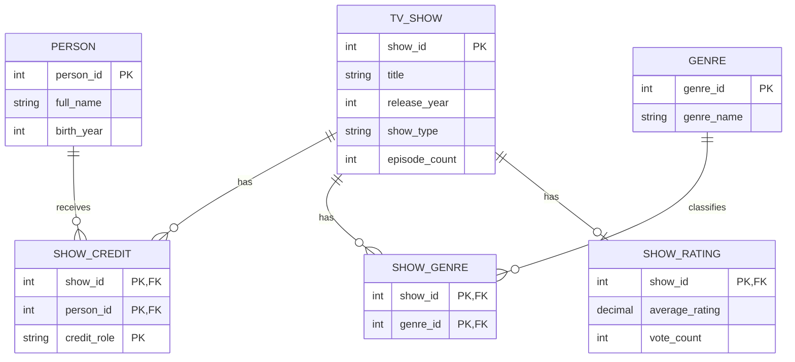

# TV Show Catalog ERD

## Assumptions

- Different shows can share a title, and different people can share a name. Each show and person has a separate ID.
- A person can be both a star and a writer on the same show. Each show, person, and role combination appears at most once.
- A show can be listed before any credits or genres are recorded. A genre can be listed before any show uses it.
- Each show has at most one current rating summary. A show without a rating has no row in `SHOW_RATING`.