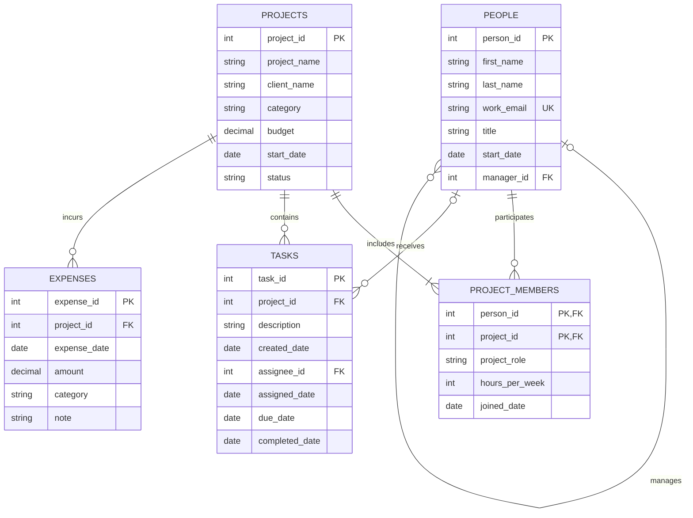

# Database Project — BabsonAI Labs

## 1. The Scenario

I chose Scenario A: BabsonAI Labs.

## 2. The ERD

## 3. What One Row Means

- One row of people represents one employee at BabsonAI Labs.
- One row of projects represents one project managed by BabsonAI Labs.
- One row of project_members represents one employee's participation in one specific project, including their role, weekly hours, and joining date.
- One row of tasks represents one task belonging to one project, which may be assigned to one employee or remain unassigned.
- One row of expenses represents one individual expense incurred by one project.

## 4. Design Choices